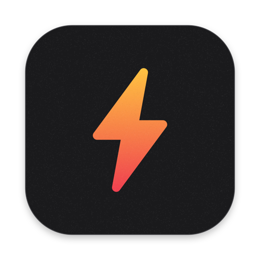
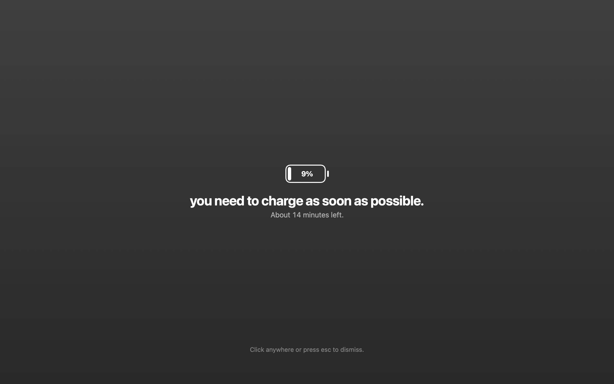
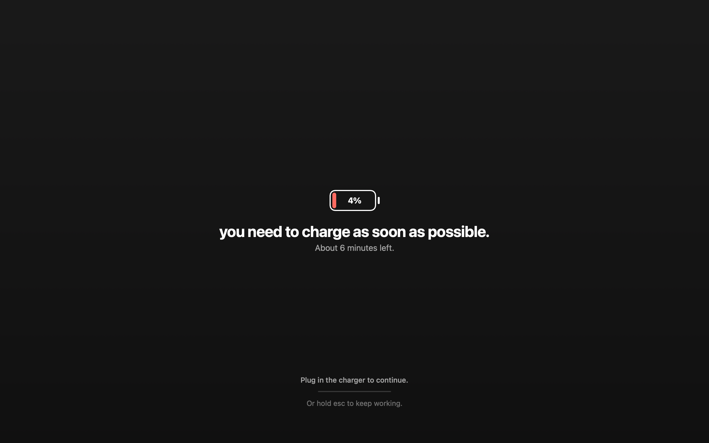

<div align="center">



# Charge Now

**Dims your screen before the battery dies. Nothing else.**

A tiny menu-bar app for Mac. At 10% it dims the screen and tells you to charge; at 5% it blocks the screen
until you plug in. For people who notice the battery only when the laptop is already off. Native Swift,
on-device, nothing uploaded.

[](https://swift.org)
[](#get-started)
[](LICENSE)
[](#status)

 

</div>

## Features

- **A warning at 10%.** The screen dims and blurs: "you need to charge as soon as possible.", with the percent
  inside a small battery and the time macOS expects is left. One click or Esc dismisses it.
- **A block at 5%.** The same screen, darker, on every display. It stays until the charger is plugged in, even
  if you dismissed the warning.
- **Never a dead end.** Hold Esc (or the mouse) for two seconds to keep working. The block comes back at the
  next percent: 4%, 3%, 2%, 1%.
- **Gone the moment you plug in.** No button to press.
- **Costs nothing while it waits.** macOS tells the app when the battery changes; the app only looks again
  once a minute as a safety net.
- **Menu bar.** A small bolt: the battery right now, Preview Warning, Preview Block, Launch at Login (on from
  the first start), Quit.

## Get started

```bash
git clone https://github.com/vekaev/charge-now && cd charge-now
scripts/install-mac.sh      # test, build, install to ~/Applications, open
```

Needs only the Xcode Command Line Tools (`xcode-select --install`), not Xcode: the scripts compile the
sources with `swiftc`. `scripts/build-app.sh` builds a universal `dist/ChargeNow-mac.dmg`.

## Settings

The thresholds live in the app's defaults. Change them, then quit and reopen Charge Now:

```bash
defaults write app.chargenow.mac warnAt -int 15        # warning, percent
defaults write app.chargenow.mac blockAt -int 7        # block, percent
defaults write app.chargenow.mac holdSeconds -float 3  # how long to hold Esc
```

## Privacy

It reads the battery level and whether the charger is connected. No network access, no analytics, no
permissions to grant.

## Status

Early, used daily by its author. Issues and ideas welcome.

## License

MIT
